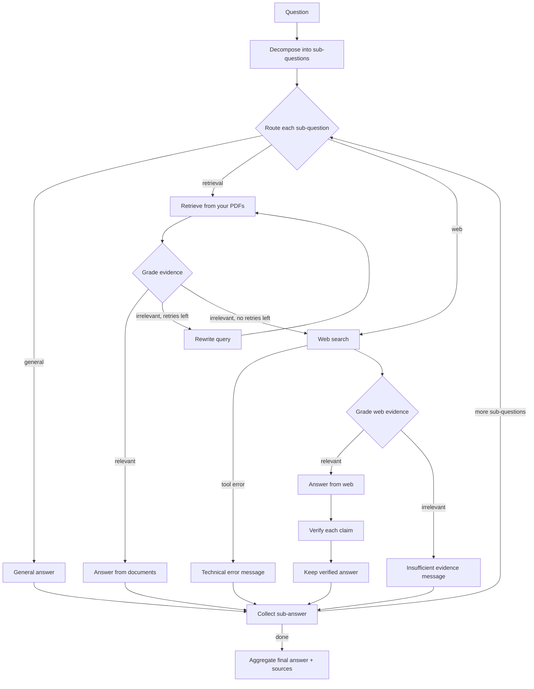

# Evida

**Research answers, with the evidence cited.**

Evida is an agentic RAG research assistant. Ask a question, and Evida decides how to answer it: from general knowledge, from your own PDFs, or from the web. It grades the evidence it finds, retries or falls back when the evidence is weak, verifies web claims, and cites every source.

**Live app:** https://evida-virid.vercel.app

---

## Features

- **Agentic answering.** A LangGraph workflow splits compound questions into parts and routes each part (general knowledge, your documents, or the web). It grades the evidence and rewrites the search query when retrieval misses.
- **Chat with your PDFs.** Upload PDFs to your library, or attach them to a single chat. Answers cite the file and page.
- **Web search with verification.** Web answers are checked claim by claim against the retrieved pages. Citations to URLs that weren't actually retrieved are removed.
- **Web search toggle.** Force a question straight to the web from the composer.
- **Honest failure modes.** When the evidence is insufficient, or a tool fails, Evida says so instead of guessing.
- **Private by design.** Supabase Row Level Security, per-user storage folders, and per-user vector filtering mean users only ever see their own data.
- **Accounts.** Sign up with first and last name, a profile view, and self-service account deletion. Deletion permanently removes every conversation, message, PDF and search-index entry, plus the account itself.
- **Conversations.** Rename, pin and delete conversations; they're grouped by date in the sidebar.
- **Responsive UI.** Desktop sidebar with a collapsible rail, mobile drawer, light and dark themes.

## Architecture

```
┌──────────────────────┐      HTTPS + Supabase JWT      ┌───────────────────────────┐
│  Frontend (Vercel)   │ ─────────────────────────────▶ │   Backend API (Render)    │
│  React · Vite · TS   │                                │   FastAPI · LangGraph     │
└──────────┬───────────┘                                └──┬──────┬──────┬──────┬───┘
           │ sign in / sign up                             │      │      │      │
           ▼                                               ▼      ▼      ▼      ▼
   ┌───────────────┐                              ┌──────────┐ ┌──────┐ ┌──────┐ ┌──────────┐
   │ Supabase Auth │◀─────────────────────────────│ Supabase │ │Chroma│ │ Groq │ │  Tavily  │
   └───────────────┘   (token verified per call)  │ Postgres │ │Cloud │ │ LLM  │ │web search│
                                                  │ +Storage │ │vector│ └──────┘ └──────────┘
                                                  └──────────┘ └──────┘
```

| Layer | Technology |
|---|---|
| Frontend | React 19, Vite, TypeScript, React Router, react-markdown, Supabase JS, lucide-react |
| Backend | FastAPI, LangGraph, LangChain |
| LLM | Groq (`openai/gpt-oss-120b`) |
| Embeddings | `sentence-transformers/all-MiniLM-L6-v2`, run in the backend |
| Vector store | Chroma Cloud |
| Web search | Tavily |
| Auth, database, files | Supabase Auth, PostgreSQL with RLS, private Storage bucket |
| Hosting | Vercel (frontend), Render (backend) |

### How a question is answered



- **Retrieval** searches only the documents the conversation may use: the files attached to that chat if there are any, otherwise the user's library. It always filters by `user_id`.
- Retrieval is retried up to **2** times with a rewritten query before falling back to the web.
- When **web search is on**, the router is skipped and every sub-question goes to the web.

## Repository layout

```
evida/
├── backend/
│   ├── app/
│   │   ├── main.py            # FastAPI app, CORS, routers, /health, /auth/me
│   │   ├── api/               # chat, conversations, messages, documents, account
│   │   ├── core/              # settings (pydantic-settings), token verification
│   │   ├── graph/             # LangGraph state, workflow and nodes
│   │   ├── ingestion/         # PDF loading/chunking, Chroma vector store
│   │   └── services/          # Supabase clients (per-user, RLS-scoped)
│   ├── migrations/            # SQL migrations 001–010 (run in order)
│   ├── scripts/ingest_pdf.py  # index a local PDF from the command line
│   ├── tests/                 # pytest (unit, plus live/ and db/ suites)
│   └── requirements.txt
└── frontend/
    ├── src/
    │   ├── auth/              # session context, route guards, auth errors
    │   ├── components/        # chat, documents, layout, common UI
    │   ├── pages/             # sign in, sign up, chat, library
    │   ├── services/          # API client (attaches the access token), Supabase
    │   └── utils/             # citations, date grouping, markdown helpers
    ├── public/                # icons, Open Graph image, web manifest
    └── vercel.json            # SPA rewrites (deep links and refreshes)
```

## Getting started

### Prerequisites

- Python 3.12+ and Node.js 20+
- A [Supabase](https://supabase.com) project
- A [Chroma Cloud](https://trychroma.com) database
- API keys for [Groq](https://console.groq.com) and [Tavily](https://tavily.com)

### 1. Supabase (one-time setup)

1. **Database:** in the SQL Editor, run every file in `backend/migrations/` **in order**, from `001` to `010`. Run each one once.

   | Migration | Purpose |
   |---|---|
   | 001 | Tables (`profiles`, `conversations`, `messages`, `documents`), indexes and RLS policies |
   | 002 | Storage policies: each user can only access their own folder |
   | 003–007 | Message sources, `indexed_at`, pinning, per-chat attachments |
   | 008–009 | First and last name on profiles (filled by a sign-up trigger) |
   | 010 | `delete_current_user()`, used for self-service account deletion |

2. **Storage:** create a **private** bucket named `evida-documents`.
3. **Authentication → URL Configuration:**
   - Set **Site URL** to your frontend URL.
   - Add `http://localhost:5173/**` and your production URL plus `/**` to **Redirect URLs**.
4. *(Optional)* **Authentication → Providers → Email:** turn **Confirm email** off to let new users sign in straight after signing up.

### 2. Backend

Copy `backend/.env.example` to `backend/.env` and fill in the values:

```env
GROQ_API_KEY=
GROQ_MODEL=
EMBEDDING_MODEL=
COLLECTION_NAME=

TAVILY_API_KEY=

SUPABASE_URL=
SUPABASE_PUBLISHABLE_KEY=

CHROMA_API_KEY=
CHROMA_TENANT=
CHROMA_DATABASE=
```

| Variable | Required | Description |
|---|---|---|
| `GROQ_API_KEY` | Yes | Groq API key, for the LLM |
| `GROQ_MODEL` | No | Groq model. Default: `openai/gpt-oss-120b` |
| `EMBEDDING_MODEL` | No | Embedding model. Default: `sentence-transformers/all-MiniLM-L6-v2` |
| `COLLECTION_NAME` | No | Chroma collection name. Default: `evida_documents` |
| `TAVILY_API_KEY` | Yes | Tavily API key, for web search |
| `SUPABASE_URL` | Yes | Supabase project URL |
| `SUPABASE_PUBLISHABLE_KEY` | Yes | Supabase **publishable** key (not the service-role key) |
| `CHROMA_API_KEY` | Yes | Chroma Cloud API key |
| `CHROMA_TENANT` | Yes | Chroma Cloud tenant |
| `CHROMA_DATABASE` | Yes | Chroma Cloud database |
| `CORS_ORIGINS` | No | JSON list of allowed browser origins. Default: `http://localhost:5173`, `http://127.0.0.1:5173`, `https://evida-virid.vercel.app` |

> Changing `EMBEDDING_MODEL` or `COLLECTION_NAME` means existing PDFs must be re-indexed. Vectors from different models can't be searched together.

Then run:

```bash
cd backend
pip install -r requirements.txt
uvicorn app.main:app --reload
```

The API runs at http://localhost:8000. Interactive docs are at http://localhost:8000/docs.

### 3. Frontend

Copy `frontend/.env.example` to `frontend/.env.local` and fill in the values:

```env
VITE_SUPABASE_URL=
VITE_SUPABASE_PUBLISHABLE_KEY=
VITE_API_BASE_URL=
```

| Variable | Description |
|---|---|
| `VITE_SUPABASE_URL` | Supabase project URL (same as the backend's `SUPABASE_URL`) |
| `VITE_SUPABASE_PUBLISHABLE_KEY` | Supabase publishable key |
| `VITE_API_BASE_URL` | Backend URL, such as `http://localhost:8000` locally, or your Render URL in production |

All three are required. The app shows a configuration error if any is missing.

> Every `VITE_` variable is bundled into the browser build. Never put server-side keys here.

Then run:

```bash
cd frontend
npm install
npm run dev
```

Open http://localhost:5173.

## API overview

Every endpoint except `/`, `/health` and the docs requires `Authorization: Bearer <Supabase access token>`.

| Method | Path | Description |
|---|---|---|
| `GET` | `/health` | Health check |
| `GET` | `/auth/me` | The signed-in user |
| `POST` | `/chat/` | Ask a question in a conversation. Body: `conversation_id`, `question`, optional `attachment_ids` and `web_search`. Saves the question and the answer. |
| `GET` / `POST` | `/conversations/` | List or create conversations |
| `PATCH` / `DELETE` | `/conversations/{id}` | Rename, or delete (including its attachments) |
| `PATCH` | `/conversations/{id}/pin` | Pin or unpin |
| `GET` / `POST` | `/conversations/{id}/messages/` | List messages in a conversation, or add one directly |
| `GET` / `POST` | `/documents/` | List, or upload a PDF (library, or attached to a chat) |
| `POST` | `/documents/{id}/index` | Extract, chunk and index a PDF |
| `GET` | `/documents/{id}/url` | Short-lived signed URL for viewing |
| `DELETE` | `/documents/{id}` | Delete a PDF and its search-index chunks |
| `DELETE` | `/account/` | Permanently delete the account and all of its data |

## Data, privacy and security

- **Authentication:** the backend verifies the Supabase access token on every request. Database and storage calls run **as that user**, so Postgres RLS and Storage policies enforce access, not only the API code.
- **Isolation:** each user's PDFs live under `evida-documents/{user_id}/`. Every vector chunk is tagged with `user_id` and `document_id`, and every search and delete filters on them.
- **Account deletion** runs in this order: storage files → Chroma chunks → the auth user. All database rows are then removed by `ON DELETE CASCADE`. The account is deleted last, so a failed step can simply be retried.
- **Secrets:** only the Supabase **publishable** key is used. No service-role key is needed.

## Testing

**Backend.** The unit tests use an in-memory Chroma store and need no external services:

```bash
cd backend
pytest --ignore=tests/live --ignore=tests/db --ignore=tests/test_scripts_real_workflow
```

`tests/live`, `tests/db` and `tests/test_scripts_real_workflow` call Groq, Tavily and Supabase, and need real credentials.

**Frontend:**

```bash
cd frontend
npm run lint
npm test        # Vitest
npm run build   # type-check and production build
```

## Deployment

- **Frontend → Vercel:**
  - Set the project root to `frontend` and add the three `VITE_` variables.
  - `vercel.json` rewrites every path to `index.html`, so refreshing or deep-linking a route like `/library` works.
- **Backend → Render:**
  - Root directory: `backend`
  - Build: `pip install -r requirements.txt`
  - Start: `uvicorn app.main:app --host 0.0.0.0 --port $PORT`
  - Add the backend environment variables. If the frontend isn't at `https://evida-virid.vercel.app`, set `CORS_ORIGINS` to include its URL.
- **Supabase:** point the Site URL and Redirect URLs at the production frontend.

> **Memory note:** the embedding model runs inside the backend process. On a 512 MB instance, indexing PDFs and PDF-based answers can exceed the memory limit, so use an instance with more RAM. Deletes don't load the model.

## Limitations

- Only PDFs, up to **10 MB**, with extractable text. Scanned PDFs need OCR first.
- PDFs are split into 1,000-character chunks with a 200-character overlap. Answers use the top matching chunks, not the whole document.
- Answer quality depends on the LLM and on Tavily's search results. Always check the cited sources.
